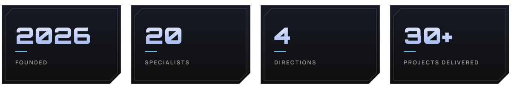
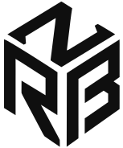

 

**🇷🇺 [Русский](#-о-компании)** &nbsp;·&nbsp; **en [English](#-about)**

 

## ⚡ О компании

**RZB Tech** проектирует и разрабатывает CRM, ERP, AI-автоматизацию, Telegram Mini Apps и веб-платформы.

Мы строим технологическую основу бизнеса — автоматизацию, аналитику, управление и цифровые сервисы. Помогаем компаниям автоматизировать работу, принимать заявки, управлять клиентами и запускать современные цифровые продукты.

 

 

## 🧩 Направления

<table>
<tr>
<td width="50%" valign="top">

### 📊 CRM-системы
Клиентская база, воронка продаж, роли сотрудников, отчёты, интеграции с сайтом и Telegram.

</td>
<td width="50%" valign="top">

### 🤖 Telegram-боты
Приём заявок, консультации, продажи, онлайн-оплата, уведомления менеджерам, выгрузка в CRM.

</td>
</tr>
<tr>
<td width="50%" valign="top">

### 🌐 Сайты для бизнеса
Корпоративные сайты и лендинги: адаптивность, готовность к SEO, админ-панель для правок без разработчика.

</td>
<td width="50%" valign="top">

### 📱 Telegram Mini Apps
Веб-приложения внутри Telegram: каталог, заявки, личный кабинет, оплата, уведомления, интеграция с CRM.

</td>
</tr>
</table>

 

## 🚀 Продукт

<table>
<tr>
<td>

### Qubnix
Корпоративный таск-менеджер для компаний и личного использования: задачи, дедлайны и контроль эффективности команды.

`B2B SaaS` `Task Tracking` `Team Management`

</td>
</tr>
</table>

 

## 🛠 Как мы работаем

**Анализ задачи → Проектирование архитектуры → UX/UI-дизайн → Разработка → Тестирование и запуск** — и сопровождение после запуска.

 

## 📬 Контакты

| | |
|:--|:--|
| 🌐 **Сайт** | [rzbtech.uz](https://rzbtech.uz) |
| ✈️ **Telegram** | [@rzbtech](https://t.me/rzbtech) |
| 📸 **Instagram** | [@rzb.tech](https://www.instagram.com/rzb.tech) |
| ✉️ **Email** | [info@rzbtech.uz](mailto:info@rzbtech.uz) |
| 📍 **Адрес** | г. Ташкент, Мирзо-Улугбекский район, MSG Navnihol |

 

---

 

## ⚡ About

**RZB Tech** designs and builds CRM, ERP, AI automation, Telegram Mini Apps and web platforms.

We build the technical foundation of a business — automation, analytics, management and digital services — and help companies automate work, accept applications, manage customers and launch modern digital products.

 

 

## 🧩 What we do

<table>
<tr>
<td width="50%" valign="top">

### 📊 CRM systems
Customer base, sales pipeline, staff roles, reports, integrations with websites and Telegram.

</td>
<td width="50%" valign="top">

### 🤖 Telegram bots
Application intake, consultations, sales, online payments, manager notifications, export to CRM.

</td>
</tr>
<tr>
<td width="50%" valign="top">

### 🌐 Business websites
Corporate sites and landing pages — mobile-friendly, SEO-ready, with an admin panel to edit content without a developer.

</td>
<td width="50%" valign="top">

### 📱 Telegram Mini Apps
Web apps inside Telegram: catalog, applications, personal account, payments, notifications, CRM integration.

</td>
</tr>
</table>

 

## 🚀 Product

<table>
<tr>
<td>

### Qubnix
A corporate task manager for teams and personal use: tasks, deadlines and team performance tracking.

`B2B SaaS` `Task Tracking` `Team Management`

</td>
</tr>
</table>

 

## 🛠 How we work

 

## 📬 Contact

**RZB Tech** · MSG Navnihol, Mirzo-Ulugbek district, Tashkent · [rzbtech.uz](https://rzbtech.uz) · [Telegram](https://t.me/rzbtech) · [Instagram](https://www.instagram.com/rzb.tech) · [info@rzbtech.uz](mailto:info@rzbtech.uz)

 

  <picture>
    <source media="(prefers-color-scheme: dark)" srcset="../assets/rzb-logo.svg" />
    
  </picture>
   
  © RZB Tech · Tech Systems

